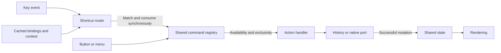

# TDD-0001. Shared commands and shortcut routing

**Status:** Accepted
**Accepted:** 2026-11-01
**Date:** 2026-11-01
**Decision:** [ADR-0008](../adr/0008-shared-commands-and-shortcut-router.md)
**Validation:** [Shortcut regression contracts](../testing/shortcut-regressions.md)

## Purpose and scope

Provide one reusable action path for buttons, shortcuts, and future menus, with
typed arguments, testable availability rules, and explicit overrides. Separate
keyboard matching from backend mutations and preserve main-window ownership of
selection while the preview has focus.

This design covers frontend commands, in-window shortcuts, settings integration,
and preview forwarding. It does not redesign preview placement, Rust storage,
the global summon hotkey, undo/redo, or multi-key shortcut sequences. The rationale
and alternatives belong to the linked ADR.

## Module responsibilities

| Module | Responsibility |
|---|---|
| [commands.ts](../../src/commands.ts) | Generic typed command registry, handler replacement, scoped overrides, availability and execution |
| [app/commands.ts](../../src/app/commands.ts) | Application IDs/argument tuples, handlers, selection resolution and backend ports |
| [app/shortcut-definitions.ts](../../src/app/shortcut-definitions.ts) | Catalog of bindings, scopes, labels, legacy settings keys and command invocation |
| [shortcuts.ts](../../src/shortcuts.ts) | Synchronous routing, context checks, binding precedence, conflicts and disposal |
| [shortcut-combo.ts](../../src/shortcut-combo.ts) | Shared canonical representation for event recording and saved combinations |
| [ui/keyboard.ts](../../src/ui/keyboard.ts) | Router composition, cached settings and cross-window subscriptions |
| [ui/settings.ts](../../src/ui/settings.ts) | Recording, configurable fields, validation, saving and binding updates |
| [ui/controls.ts](../../src/ui/controls.ts) | Header buttons invoke commands; rendering follows shared store flags |
| [app/history.ts](../../src/app/history.ts) | History operations using injectable typed backend and preview ports |
| [main.ts](../../src/main.ts) | Creates one shared registry per webview and connects renderer, selection and UI bindings |

The obsolete `actions.ts` wrappers are removed. Command handlers invoke history
operations or injected native ports; keyboard callbacks do not duplicate mutations.

## Execution flow



The router installs one capture listener and chooses one eligible binding. It
consumes the matched event before starting work that may yield. Unmatched keys,
composition events, and previously consumed events remain outside its action path.
Binding providers return cached strings synchronously; they cannot return promises.

The registry resolves the current handler and checks its `enabled` predicate at
execution time. `exclusive: true` drops overlapping invocations for that command
ID until the pending operation settles. Different command IDs do not share a lock.
Actions use the current selected item unless an explicit item ID was supplied.

`execute` returns `Promise<boolean>`: true means the handler completed, while a
missing, disabled, busy exclusive, or failed command returns false. Failures go
to an injectable error reporter (console logging by default). Backend mutation
failures leave the relevant state unchanged; locks are released after failure.
`canExecute` queries handler availability; it does not report the in-flight lock.
There is no automatic queue, undo operation, or user-facing error notification.

## Command and binding overrides

Command overrides and key overrides are independent:

- `commands.register(id, definition)` replaces the base handler. Its disposer
  cannot remove a newer replacement with the same ID.
- `commands.override(id, definition)` adds a temporary handler scope. The newest
  remaining scope wins, including when disposers run out of order. Removing all
  scopes reveals the base handler. Each override owns its availability predicate.
- `keyboard.manager.setBindings(bindings)` replaces the saved binding layer.
- `keyboard.manager.overrideBindings(bindings)` adds a disposable temporary layer.

| Binding precedence | Resolution |
|---|---|
| Highest | Newest temporary scope that specifies the binding ID |
| Next | Saved user binding |
| Lowest | Catalog default |
| Tie within a layer | Higher explicit priority, then latest registration |

Only eligible bindings compete; typing/context rules still apply. A null or empty
binding disables that ID. Removing a saved override reveals its default.
`getConflicts()` reports overlapping effective combinations. The low-level router
has deterministic conflict resolution; the settings UI rejects conflicts before
persistence, including collisions with fixed navigation bindings.

## Canonical combinations and context

Modifiers use the order `Ctrl`, `Meta`, `Alt`, `Shift`, followed by the key.
Recording, matching, and validation share this representation and supported
aliases. Additional modifiers remain significant: `Ctrl+Shift+P` differs from
`Ctrl+P`. Malformed combinations are rejected; modifier-only events are not recorded.

The catalog assigns list, search, tab, or escape scope. Typing in an input,
textarea, or editable region blocks ordinary item shortcuts. Specific search
operations may opt into the search field. Settings inputs are protected from
application commands while recording. Escape in search blurs it; Escape in
settings closes settings when focus permits; otherwise it hides the window.
Shortcut scope and command availability are separate checks: an action can be
unavailable even when its key combination matches.

## Settings and persistence

1. Load bindings asynchronously at startup. Catalog defaults are available while
   the initial load is pending; a load failure is logged and leaves defaults.
2. Record combinations through the shared normalizer. Backspace clears a field;
   saving an empty string explicitly disables that binding.
3. Validate malformed or conflicting combinations before native save calls.
4. After a successful save, update the main cache immediately and send the new
   settings to the preview. A failed save leaves the active cache unchanged.
5. A revision counter prevents an older in-flight load from overwriting a newer
   save. `refreshSettings()` explicitly reloads changes made outside the save flow.

The Rust settings map retains its existing string keys (`search`, `pause`,
`pinItem`, `delete`). The catalog translates these into action IDs. New entries
with a `settingsKey` can use the existing map without a Rust schema change.
Unknown saved entries are preserved by the UI. Typed IPC declarations describe
the expected payloads; they do not provide runtime payload validation.

## Preview routing and lifecycle

Each webview has its own router/cache. Main owns selection and mutation state.

| Event | Direction | Meaning |
|---|---|---|
| `preview-forward-key` | Preview → main | Execute an allowlisted canonical navigation/escape key |
| `preview-command` | Preview → main | Invoke an allowlisted catalog action ID |
| `shortcuts-updated` | Main → preview | Apply successfully saved bindings |

Main rejects unknown forwarded IDs/keys and respects settings context. Preview
does not mutate a local history selection. This retains the ownership model in
[ADR-0007](../adr/0007-preview-separate-window-with-dock-fallback.md).

`keyboard.dispose()` removes the key listener and native event subscriptions.
Subscriptions that finish registering after disposal are immediately detached;
late settings loads cannot reapply bindings to a disposed router. Feature code
that creates temporary command/binding scopes must retain and invoke their
disposers when its context ends. These APIs do not introduce a general application
mount/unmount lifecycle for every existing controller.

## Extension recipes

### Add a command and optional shortcut

1. Add the command ID and argument tuple to `AppCommandArgs` in `app/commands.ts`.
2. Register its handler, availability predicate, and exclusivity policy there.
   Inject backend dependencies so the handler can be tested without native UI.
3. Invoke `commands.execute(id, ...args)` from every UI entry point for that action.
4. Add a catalog definition with its label, default combination, scope, and `run`
   callback. Supply a stable `settingsKey` to make it configurable. New configurable
   definitions receive a settings input automatically; existing input IDs remain.
5. Add command tests for behavior and router/integration tests for the binding.

### Temporarily disable an action for every entry point

```ts
const restoreDelete = commands.override("item.delete", {
  enabled: () => false,
  execute: () => {},
});
// Buttons and shortcuts share the disabled action until this context ends.
restoreDelete();
```

### Temporarily remap or disable bindings

```ts
const restoreBindings = keyboard.manager.overrideBindings({
  "search.toggle": "Ctrl+K",
  "item.delete": null,
});
// Restore the previous effective bindings when the context ends.
restoreBindings();
```

## Validation and acceptance

The branch's latest implementation verification reported **96 passing tests**,
with no expected-failure markers, plus a passing frontend build and diff checks.
Manual acceptance is recorded below. See the
[regression guide](../testing/shortcut-regressions.md) for test scope and baseline
migration details. Run `npm test` and `npm run build` after implementation changes.

For future changes, repeat the relevant
[manual Tauri smoke checks](../testing/manual-smoke-test.md):

- Pin/delete/copy/pause behave consistently through buttons and shortcuts.
- One physical keypress invokes one action; modifier combinations remain exact.
- Search and settings inputs retain expected editing/recording behavior.
- Save, rebind, disable, reset and conflict rejection work in the native UI.
- Saved bindings work after restart and in both separate and docked preview.
- Preview forwarding, Escape, focus handoff and the OS summon hotkey still work.
**Manual validation result:** Accepted on 2026-11-01. Omar confirmed that the built
application works after manual testing and approved committing and pushing these
changes. This records the reported outcome without claiming a separate result
for every regression scenario listed above.
